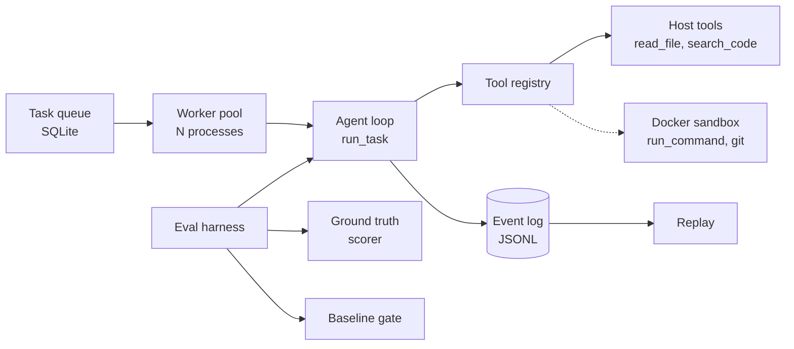

# SecTriage

SecTriage is an agent that triages code for security findings and an eval harness that scores it. The agent reads a local, intentionally vulnerable codebase with `read_file` and `search_code`, reports findings in five classes (sqli, xss, path_traversal, command_injection, hardcoded_secret), and every report is checked against a ground-truth file. Triage is the task because a finding list is only useful if each item is a real bug at a known location. That makes precision, recall and cost per run measurable, which is what the harness reports. Targets are seeded apps under `evals/targets/`; only intentionally vulnerable local targets may be scanned.

## Architecture



Dashed edges are paths that exist but are not wired into the default runs.

The queue, worker pool and replay are in `src/swarm/`. Workers run the host read-only tools only; the CLI has no sandbox flag. The loop is in `src/agent/`: every step appends one JSONL event, and the run stops at a step budget, a cost cap or a timeout. `run_command` and `git` execute through a `Sandbox` interface implemented in `src/sandbox/`: one container per task, no network, read-only root filesystem, all capabilities dropped, 1 CPU, 512 MiB and 128 processes (`src/sandbox/config.py`, tested in `tests/sandbox/`). The eval harness in `evals/` runs the agent, scores findings against `evals/ground_truth/`, and compares a summary with a saved baseline.

## Quick start

Requires Python 3.12, [uv](https://docs.astral.sh/uv/) and Docker.

```bash
uv sync
uv run pytest -q
docker build -t sectriage-sandbox:1 src/sandbox
uv run pytest -q -m docker
uv run python -m src.swarm.demo
uv run python -m evals.run --summary-file evals/results/ledger_api-steps30.json --baseline evals/baselines/ledger_api.json
```

- `uv run pytest -q` runs the whole suite. Build the image before relying on the Docker tests (`-m docker` runs only those).
- The swarm demo needs no API key, no network and no Docker. It uses a scripted model, kills a worker mid-task, and finishes with one result row after two attempts. It takes about 20 seconds.
- The last command prints a saved summary offline and checks it against the baseline. It ends with `gate: PASS` when there is no regression.
- Live agent runs need `ANTHROPIC_API_KEY` in `.env` and cost money. See `evals/CLAUDE.md`.

The merge gate: `uv run pytest -q`, `uv run ruff check .` and `uv run ruff format --check .` pass, and the eval gate above shows no regression.

## Results

Model `claude-haiku-5-5`, prompt v1, tools `read_file` and `search_code`, no sandbox, 5 runs per row, 5 planted bugs per target, prices verified 2026-10-24. Recall and precision are means over the 5 runs. All 40 runs finished cleanly with no false positives.

### Step budget

| Target | Max steps | Recall | Precision | Mean cost (USD) | Mean steps | Source |
|---|---|---|---|---|---|---|
| ledger_api | 6 | 0.20 | 1.00 | 0.0014 | 6.0 | `evals/results/ledger_api-steps06.json` |
| ledger_api | 10 | 0.36 | 1.00 | 0.0021 | 10.0 | `evals/results/ledger_api-steps10.json` |
| ledger_api | 15 | 0.44 | 1.00 | 0.0033 | 15.0 | `evals/results/ledger_api-steps15.json` |
| ledger_api | 30 | 1.00 | 1.00 | 0.0045 | 18.4 | `evals/results/ledger_api-steps30.json` |
| notes_portal | 6 | 0.28 | 1.00 | 0.0015 | 6.0 | `evals/results/notes_portal-v1-steps06.json` |
| notes_portal | 10 | 0.36 | 1.00 | 0.0023 | 10.0 | `evals/results/notes_portal-v1-steps10.json` |
| notes_portal | 15 | 0.40 | 1.00 | 0.0034 | 15.0 | `evals/results/notes_portal-v1-steps15.json` |
| notes_portal | 30 | 0.92 | 1.00 | 0.0044 | 17.8 | `evals/results/notes_portal-v1-steps30.json` |

Recall is low at small budgets because the agent runs out of steps before it reports. At 30 steps the runs end before the budget is used. `ledger_api` was used to write the v2 prompt (see below); `notes_portal` was not used for tuning.

### Semgrep comparison

Semgrep 1.182.1 with packs `p/python`, `p/flask`, `p/security-audit` and `p/secrets` was scored on the same ground truth as the agent, on `ledger_api`, `notes_portal` and `static_builder` together (10 planted bugs). Source: `evals/results/static-scanner-semgrep-1.182.1.json`. One run; the registry rules need network, so only rescoring from the saved findings file is offline.

| | Recall | Precision | False positives |
|---|---|---|---|
| Semgrep, 10 planted bugs across 3 targets | 0.30 (3 of 10) | 0.75 | 1 |
| Agent, 30 steps, `ledger_api` | 1.00 | 1.00 | 0 per run |
| Agent, 30 steps, `notes_portal` | 0.92 | 1.00 | 0 per run |

Agent sources: `evals/results/ledger_api-steps30.json`, `evals/results/notes_portal-v1-steps30.json`. On `static_builder`, which has no planted bugs, the agent produced no false positives in 5 of 5 runs (`evals/baselines/static_builder.json`).

Semgrep recall by class: command_injection 1.0, xss 0.5, sqli 0.0, path_traversal 0.0, hardcoded_secret 0.0. Its one false positive is on an escaped-output decoy in `notes_portal` (`evals/results/static-scanner-semgrep-1.182.1.decoys.json`). Rules outside the five scored classes are dropped before scoring. The rows are not like for like: Semgrep is one deterministic run over three targets, the agent rows are 5 runs per target.

## Prompt v2 experiment

Prompt v2 adds one instruction: report each finding as soon as it is verified. It was run on both targets at 6, 10, 15 and 30 steps, with 5 runs per cell. Prompt v1 stayed the default and v2 was not merged; v2 exists only on the tag `prompt-v2-experiment`. Against the five success criteria written beforehand, v2 met 2 of 5 on `ledger_api` and 1 of 5 on `notes_portal`. At 15 steps recall rose from 0.44 to 0.72 on `ledger_api` and from 0.40 to 0.76 on `notes_portal`. At 30 steps `notes_portal` recall fell from 0.92 to 0.84, and one of the 40 v2 runs had a false positive. Full tables, setup and reproduction steps are in [docs/experiments/prompt-v2.md](docs/experiments/prompt-v2.md).

## Limits

- The targets are four small seeded apps with at most 5 planted bugs each. One model, 5 runs per cell. The numbers above say nothing about real codebases.
- Only the five classes are scored. Other issue types are dropped, not counted for or against.
- Patch quality is not measured. The agent can attach a patch to a finding, but `patch_pass_rate` is empty in every result file.
- The eval runs above used no sandbox. The sandbox is tested with Docker and has had live runs, but no run where the model chose `run_command` on its own.
- The `semgrep` and `git` agent tools build their command lines on the host and are unverified against a real run. The sandbox image does not contain Semgrep. The Semgrep comparison above is a separate scanner run, not an agent tool.
- The queue is SQLite. Workers use host read-only tools only. The demo uses a scripted model, and replay is exact only for host tools on frozen targets.
- There is no tracing and no model routing.
- The agent does not send a temperature, so repeatability rests on the pinned model, the prompt version and repeated runs.
- Targets are frozen (`evals/targets.lock.json`). Results on a changed target are not comparable with earlier ones.

## Repo layout

```
src/
  contracts.py      event, task and tool schemas
  agent/            loop, prompts, model client, memory, tool registry
  sandbox/          Docker runner, config, Dockerfile for the sandbox image
  swarm/            SQLite queue, worker pool, replay, CLI, demo
evals/
  targets/          seeded vulnerable apps (vuln_app, ledger_api, notes_portal, static_builder)
  ground_truth/     expected findings and decoys per target
  baselines/        saved summaries used by the regression gate
  results/          saved run summaries and the Semgrep comparison
  run.py            eval CLI: summary, scoring, gate
  scorer.py, metrics.py, results.py, baseline.py, static_scanner.py
tests/              pytest suite (agent, sandbox, swarm, evals)
scripts/verify.sh   environment checks (needs ANTHROPIC_API_KEY set)
docs/               architecture notes, lane plans, experiments/prompt-v2.md
```
